# Data Visualization

## Compare candidate approval ratings

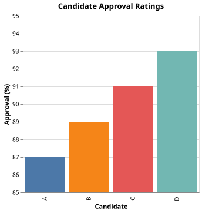{fig-alt="bar chart, y-axis starts at 85"}

Compare the visual height of candidate A's bar to candidate D's bar. How much larger
does D appear? Now look at the actual numbers. How large is the real difference?

Show explanation

The Y-axis starts at 85 instead of 0. Candidate D's approval (93%) is only 6
percentage points above candidate A's (87%), but the bars make it look roughly
three times taller. Any bar chart where the Y-axis does not start at zero
exaggerates relative differences. The effect is proportional to how far the
baseline is raised: the higher the floor, the more dramatic the distortion.

Shows: how a non-zero baseline inflates visual differences in bar charts out of
proportion to the underlying data.

To find it: check where the Y-axis starts. If it starts above zero on a bar chart,
divide the visual height ratio of two bars by their actual data ratio. If the visual
ratio is several times larger than the data ratio, the truncated axis is distorting
the comparison.

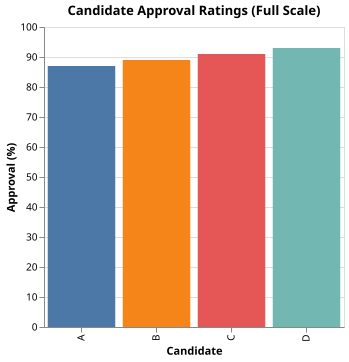{fig-alt="bar chart, y-axis starts at 0"}

## Assess a product's long-term performance trend

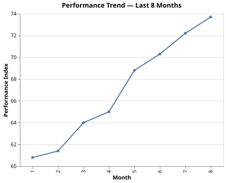{fig-alt="line chart of an 8-month uptrend"}

The chart shows a clear upward trend over 8 months. What conclusion might you draw
about this product's long-term trajectory? What information would you need to know
whether this is reliable?

Show explanation

The 8 months shown are a recovery from a multi-year decline. The full 5-year series
falls from 100 to roughly 52 before the recent uptick. Choosing a start date at the
bottom of a trough guarantees an upward slope. This pattern is common in financial
and performance reporting: selecting the window that flatters the story while
omitting the longer context that contradicts it.

Shows: how selecting a window that starts at a historical low manufactures an
upward trend that disappears when the full series is shown.

To find it: ask what the full dataset covers and compare the chart's start date to
the earliest available data. If the start date coincides with a local minimum, extend
the chart to show the complete history. If only the selected window is available,
that absence of context is itself a warning sign.

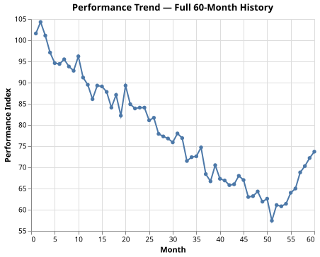{fig-alt="line chart of the full 60 months"}

## Interpret the relationship between coffee consumption and code commits

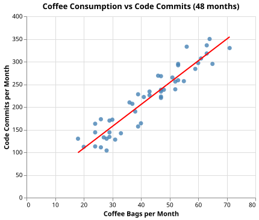{fig-alt="scatter plot of coffee vs commits"}

The scatter plot shows a strong positive relationship between monthly coffee
consumption and code commits, with a tight regression line. What conclusion might
a reader draw? What third factor might explain the pattern?

Show explanation

Both metrics grow because the engineering team grew: more engineers means more commits
and more coffee consumed. Plotting two time-trending variables against each other
removes the time axis entirely and makes a shared common cause look like a direct
relationship between the two variables. Any two series that both trend in the same
direction will produce a scatter that looks correlated, regardless of whether they
have anything to do with each other.

Shows: how two variables driven by the same common cause (team size) appear
strongly correlated in a scatter plot even when there is no direct relationship
between them.

To find it: color the scatter plot points by time, with early months dark and late
months light. If early months cluster in one corner and late months in the opposite,
the apparent correlation is temporal ordering rather than a direct relationship. Then
ask whether a plausible common cause — such as growth in team size — could explain
both trends independently.

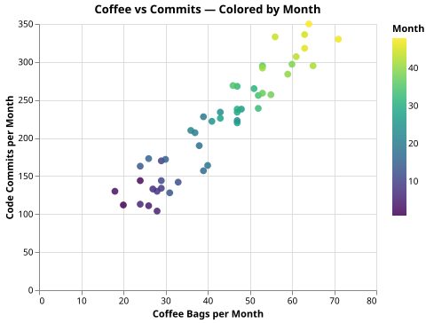{fig-alt="scatter plot, points colored by month"}

Early months cluster in the lower left and late months in the upper right — the
apparent correlation is entirely temporal ordering.

## Interpret the relationship between study hours and exam scores

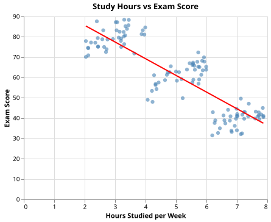{fig-alt="scatter plot with a downward slope"}

The trend line shows that students who study more tend to score lower. Does that
mean studying is counterproductive? What might explain the pattern?

Show explanation

Students in harder courses study more hours but earn lower scores because the courses
are harder, not because studying hurts performance. Within each difficulty level the
relationship is positive: more study leads to higher scores. The aggregate trend
reverses because a third variable — course difficulty — drives both the study hours
and the scores. Adding a color encoding for difficulty would reveal three upward
slopes instead of one downward one. This is Simpson's Paradox: an aggregate trend
that disappears or reverses when a confounding variable is introduced.

Shows: how a confounding variable can reverse the direction of an aggregate trend,
making a genuinely positive relationship appear negative in the pooled data.

To find it: color or facet the scatter plot by a categorical variable you suspect
might be driving the outcome—here, course difficulty. If the aggregate slope
reverses within each group, the confound is real. List candidate confounds before
looking at the data: any variable that plausibly affects both axes is worth testing.

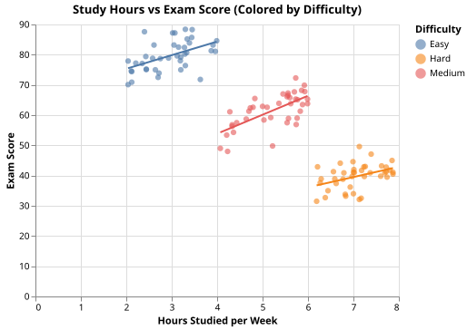{fig-alt="scatter plot with three upward slopes"}

## Compare two groups by average score

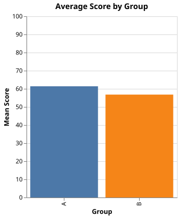{fig-alt="bar chart of two group means"}

Both groups have nearly the same average score. Would you conclude they are
performing similarly? What other chart type would you choose before drawing that
conclusion?

Show explanation

Group A is roughly normally distributed around 62. Group B is bimodal: half the
students score near 25 and half score near 90. Both groups have the same mean, but
their situations are completely different — Group B has two distinct subpopulations
that the mean obscures entirely. A strip plot, histogram, or violin chart would make
the bimodal structure immediately visible. Reporting only the mean discards the
information most relevant to understanding Group B.

Shows: how identical means can hide completely different distributions, including
bimodal structure that would demand a different response from an educator or
manager.

To find it: replace the bar chart of means with a strip plot, histogram, or violin
chart of the raw values. If the two groups look different in the distribution chart
despite identical averages, or if one group shows two distinct clusters, the mean
was suppressing the most important information in the data.

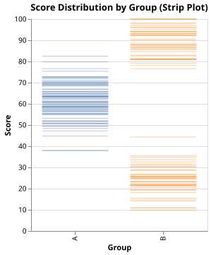{fig-alt="strip plot of individual scores"}

## Identify which city has the worst traffic safety record

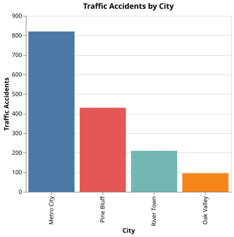{fig-alt="bar chart of raw accident counts"}

Which city appears to have the most serious traffic safety problem? Now calculate
accidents per 100,000 residents for each city using the figures below. Does the
ranking change?

Metro City: 820 accidents, population 2,100,000.
River Town: 210 accidents, population 180,000.
Oak Valley: 95 accidents, population 52,000.
Pine Bluff: 430 accidents, population 640,000.

Show explanation

Metro City's raw count is largest, but its rate is 39 per 100,000 — the lowest of
the four. Oak Valley has only 95 accidents but a rate of 183 per 100,000 — nearly
five times higher. Absolute counts favor larger populations and are only meaningful
when comparing groups of similar size. Any comparison that involves groups of
different sizes requires a denominator: rate, proportion, or per-capita figure.

Shows: why absolute counts mislead whenever the groups being compared differ in
size, and how normalizing to a rate can reverse the apparent ranking entirely.

To find it: divide each group's count by its population (or another appropriate
denominator) and compare the normalized rates. If the rankings change after
normalizing, the raw counts were misleading. As a rule of thumb, if the groups
differ in size by more than a factor of two, rates are almost always more
informative than counts.

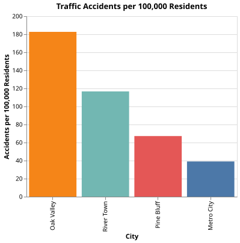{fig-alt="bar chart of accident rates"}

## Assess a product's user growth over the past year

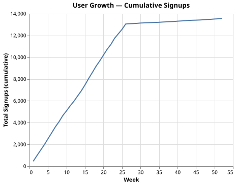{fig-alt="line chart of cumulative signups"}

The total user count is rising steadily. Would you describe the product as growing?
Now think about what the weekly rate of new signups looks like in the second half of
the year compared to the first.

Show explanation

A cumulative chart can only go up or stay flat: it can never show a decline even if
new additions stop entirely. Weeks 1-26 add 400-600 users each; weeks 27-52 add
10-30. The product's growth has effectively stopped, but the cumulative line looks
like a healthy upward trend throughout. Plotting the weekly rate instead reveals the
collapse in new signups. Cumulative charts are useful for showing totals but
systematically hide any information about acceleration, deceleration, or stagnation.

Shows: how a cumulative chart makes stagnating growth look like a continuous upward
trend by construction, since it can never decrease.

To find it: compute the period-over-period difference (subtract each value from the
previous one to get weekly new additions) and plot that instead of the running total.
If the differences drop sharply while the cumulative line keeps rising, growth has
stopped even though the total continues to climb.

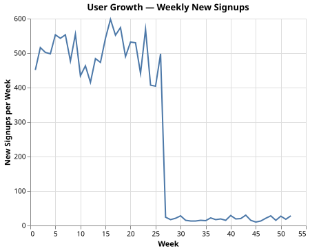{fig-alt="line chart of weekly signups"}

## Read exam scores by hours studied for 600 students

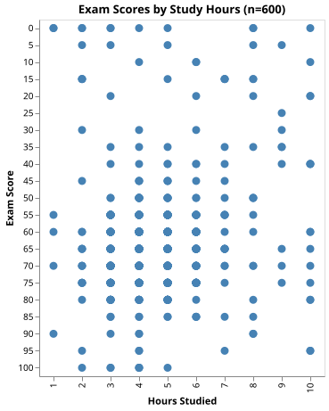{fig-alt="overplotted scatter of scores vs hours"}

How many students appear to have studied for 4 hours and scored 65? How confident
are you that each visible dot represents the same number of students?

Show explanation

Both the exam scores (multiples of 5) and hours studied (integers) are discrete, so
many students share the same coordinates. Opaque markers stack on top of each other
and become indistinguishable from a single point: a position with 40 students on top
of each other looks identical to a position with 1. The chart gives no indication
of how populated each cell is, making the data appear uniformly distributed when 80%
of students cluster at 3-6 hours and scores of 55-75.

Shows: how opaque markers on discrete data hide density by stacking invisibly,
making a heavily skewed distribution look uniform.

To find it: set the marker opacity to a low value (such as 10-20%) or replace the
scatter plot with a bubble chart where marker area encodes count. If the chart looks
dramatically different, e.g., dense clusters appearing where everything looked uniform
before, then overplotting was hiding the true distribution.

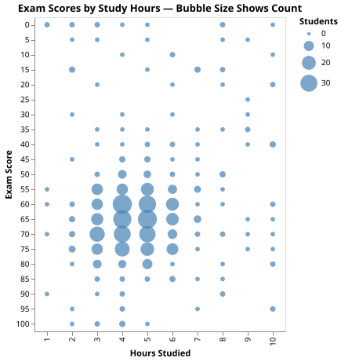{fig-alt="bubble chart sized by count"}

## Rank seven categories by market share

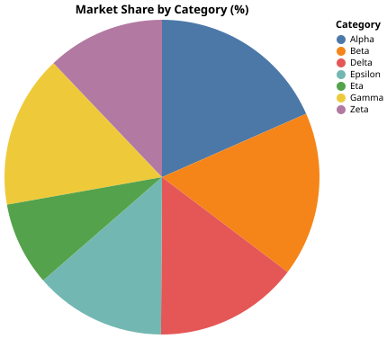{fig-alt="pie chart with seven slices"}

Without reading the exact percentages, rank the seven categories from largest to
smallest share. How confident are you in your ranking? Which pairs of adjacent
categories are hardest to distinguish?

Show explanation

Human perception of angles and arc lengths is unreliable, especially when slices are
similar in size. The shares range from 18.4% down to 8.6% — a meaningful spread —
but most readers cannot reliably rank the middle five categories without reading the
labels. A horizontal bar chart sorted by value requires only length perception, which
humans perform much more accurately. Pie charts are defensible only when there are
two or three slices with clearly different sizes.

Shows: how pie charts make ranking difficult when slices are similar in size,
because angle and arc perception is far less accurate than length perception.

To find it: try to rank all slices from memory without reading the labels. If you
cannot confidently order the middle categories, replace the pie with a bar chart
sorted by value and compare how long the ranking takes. The bar chart should be
almost instantaneous.

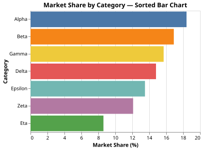{fig-alt="sorted horizontal bar chart"}

## Predict individual student scores from district income data

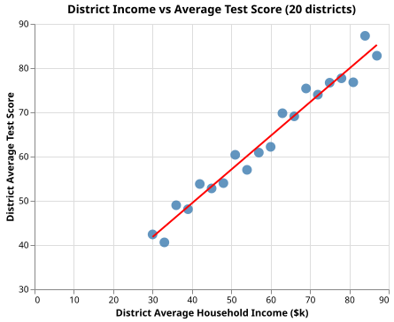{fig-alt="scatter of district averages"}

The chart shows that school districts with higher average household income have higher
average test scores, with a tight regression line. Would you expect to be able to
predict an individual student's score from knowing their district's average income?
How accurate do you think that prediction would be?

Show explanation

The district-level chart uses 20 aggregate points, so noise is suppressed and the
trend looks precise. But the district average income is a property of the district,
not the student. Within any district, students from families with very different
incomes sit in the same classrooms and take the same tests, and individual scores
scatter widely around the district mean. A statistic that explains 95% of the
variance across group averages may explain only 25-30% of the variance across
individuals, because most of the individual variance is within-group and invisible
in the aggregate chart. Drawing conclusions about individuals from group-level
correlations is the ecological fallacy.

Shows: how group-level correlations can look much tighter than individual-level
correlations, because averaging within groups suppresses within-group variance and
makes the aggregate trend appear more predictive than it is.

To find it: if individual-level data is available, plot individual points instead of
group averages. Compare the R² values for the two charts. If the individual-level
R² is substantially lower than the group-level R², the group correlation was
overstating predictive power for individuals. The gap between the two values is the
proportion of individual variance that lies within groups and is invisible in the
aggregate chart.

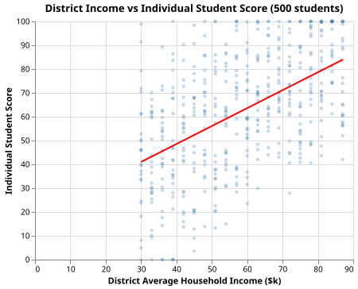{fig-alt="scatter of individual students"}

The upward trend is still present but the scatter is so wide that knowing a student's
district tells you little about that student's score.

